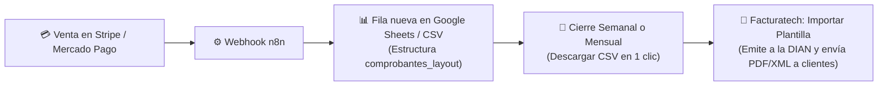

# 📑 GUÍA OPERATIVA: CARGA MASIVA DE FACTURAS VÍA CSV + N8N
### *Automatización de Emisión sin Depender de la API de Facturatech*

---

## 🎯 1. ¿POR QUÉ ESTE MÉTODO ES LA MEJOR ALTERNATIVA?

Mientras Facturatech gestiona o habilita el Token de Web Services / API:
1. **Es 100% oficial y gratuito:** No requiere comprar conectores adicionales ni pagar soporte de integración.
2. **Cero digitación:** En lugar de crear factura por factura a mano (que toma 3 a 5 minutos por cliente), n8n construye el archivo con todas las ventas del periodo.
3. **Emisión en 1 solo clic:** Entras a la pantalla de *Importar Plantilla* en Facturatech, seleccionas el prefijo `FVC`, subes el archivo CSV y el sistema emite 10, 50 o 100 facturas electrónicas a la DIAN en segundos.

---

## ⚙️ 2. EL FLUJO AUTOMATIZADO CON N8N

---

## 📋 3. COLUMNAS CLAVE DE LA PLANTILLA (`comprobantes_layout.xlsx`)

La plantilla descargada contiene las siguientes secciones indispensables que n8n llena automáticamente:

### A. Encabezado de la Factura:
* **`*NIT ADQUIRIENTE`:**
  * Colombia: Cédula del cliente o Consumidor Final (`222222222222`).
  * España: DNI / NIE del cliente o ID asignado (ej. `12345678Z`).
* **`*TIPO DE COMPROBANTE`:** `1` (Factura Electrónica de Venta).
* **`*TIPO DE FACTURA`:** 
  * `1` para Venta Nacional (Colombia).
  * `2` para Factura de Exportación (España).
* **`*TIPO DE OPERACIÓN`:** `10` (Estándar).
* **`FECHA INICIO PERIODO FACTURADO`:** Fecha de la compra (ej. `2026-11-14`).
* **`FECHA FIN PERIODO FACTURADO`:** Fecha de vencimiento del servicio (+30, +180 o +365 días).
* **`*FECHA VENCIMIENTO`:** Misma fecha de la compra (al ser de contado).

### B. Medios de Pago:
* **`*METODO DE PAGO`:** `1` (Contado).
* **`*MEDIO DE PAGO`:** `48` (Tarjeta Crédito) o `47` (Transferencia Débito) o `1` (Instrumento no definido).

### C. Ítems del Servicio:
* **`*CANTIDAD`:** `1`.
* **`CODIGO`:** `VIDEM-FLEX-01`, `VIDEM-VIP-06` o `VIDEM-VIP-12`.
* **`PRODUCTO O SERVICIO`:** Nombre del plan.
* **`UNIDAD DE MEDIDA`:** `94` (Servicio / Unidad).
* **`PRECIO UNITARIO`:** Valor del plan (ej. `49.99` o `240000`).
* **`*CODIGO DEL ESTANDAR`:** `010` (Estándar de adopción del contribuyente).
* **`*CODIGO DEL PRODUCTO`:** El mismo código interno del plan.
* **`*IMPORTE IMPUESTO`:** `0` (Excluido en Colombia / Exento en España).

---

## 🚀 4. PASO A PASO PARA IMPORTAR EN FACTURATECH

1. Entra a:  
   👉 **Comprobantes > Importar** *(pantalla de la captura)*.
2. Marca la casilla: **`☑ El archivo contiene los encabezados`**.
3. En **Prefijo:** Seleccionas tu resolución activa: **`FVC`**.
4. Haz clic en **Seleccionar archivo** y adjuntas el archivo `.csv` (guardado como *"CSV delimitado por comas"* codificado en UTF-8).
5. Haz clic en el botón azul **`Importar`**.
6. Facturatech procesa el lote:
   * Valida cada fila ante la DIAN.
   * Genera los CUFE.
   * Despacha los correos a los clientes con sus facturas electrónicas.
