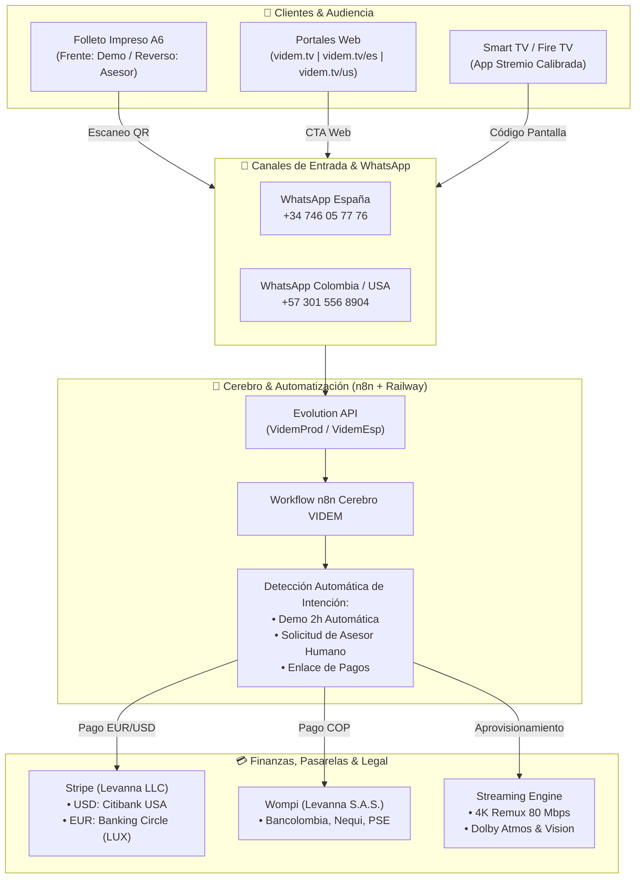

# ✦ VIDEM | Manual Maestro & Guía de Conversación
> **Versión:** 1.0 • **Última Actualización:** 25 de Noviembre, 2026  
> **Operado por:** Levanna S.A.S. (Colombia) & Levanna LLC (Estados Unidos)  
> **Propósito:** Documento de referencia técnica, comercial y operativa para navegación y apertura de hilos de trabajo sin pérdida de contexto.

---

## 🧭 1. Resumen Ejecutivo de lo Construido



---

## 📦 2. Estado Actual de Módulos Implementados

| Módulo | Archivo / Ubicación Clave | Estado Actual & Funcionalidad |
| :--- | :--- | :--- |
| **🎨 Flyer A6 Multirregión** | [comercial/flyer-videm.html](file:///c:/Users/Usuario/Documents/Proyectos%20Antigravity/VIDEM/comercial/flyer-videm.html) | • **Anverso:** Portada cinematográfica cálida con gancho de precio y QR de Demo 2 horas.<br>• **Reverso:** Paleta *Warm Cinema Espresso*, comparativa técnica, 3 planes y QR a Asesor Humano.<br>• **Selectores dinámicos:** 🇪🇸 España (9,99 €), 🇨🇴 Colombia ($55.000) y 🇺🇸 USA ($14.99).<br>• **Impresión calibrada:** Cero cortes en A6 (148 × 105 mm) y espaciado protegido entre insignias y QR. |
| **📲 QRs Diferenciados** | [assets/images/](file:///c:/Users/Usuario/Documents/Proyectos%20Antigravity/VIDEM/assets/images/) | • `qr-wa-front-*.png`: Redirige a pedir **Demo Gratis de 2 Horas**.<br>• `qr-wa-back-*.png`: Redirige a **Hablar con un Asesor / Información de Planes**.<br>• Generados en resolución de 600 px con corrección de error M. |
| **🌐 Portales Web** | `index.html`<br>`es.html`<br>`us.html`<br>`activar.html` | • **index.html:** Landing principal para Colombia (pesos COP y pasarela Wompi).<br>• **es.html:** Landing España / Europa (Euros y pasarela Stripe).<br>• **us.html:** Landing USA & Global (Dólares USD).<br>• **activar.html:** Flujo guiado para ingresar el código de 4 o 6 dígitos que emite el televisor. |
| **🤖 Bot de WhatsApp (n8n)** | [workflows/n8n_videm_whatsapp_bot.json](file:///c:/Users/Usuario/Documents/Proyectos%20Antigravity/VIDEM/workflows/n8n_videm_whatsapp_bot.json) | • Conectado a Evolution API en Railway.<br>• Maneja dos instancias: `VidemProd` (Colombia) y `VidemEsp` (España).<br>• Detección de intenciones (demo, precios, activación, asesor humano).<br>• Dispara alertas prioritarias a Camilo cuando se solicita asesor humano.<br>• Modo silencio para clientes en trato personalizado (ej. John Bedoya). |
| **💳 Pasarelas & Banca** | Stripe (`Levanna LLC`)<br>Wompi (`Levanna S.A.S.`) | • **Stripe:** Cuenta `acct_1UearrGr4WrtrXKj`. Configurado con doble divisa de liquidación (*Settlement Currencies*): **USD** a Citibank y **EUR** a Banking Circle S.A. (Luxemburgo, IBAN `LU44...8316`), evitando comisión por doble cambio de divisa.<br>• **Wompi:** Recaudos en Colombia por Bancolombia, Nequi y PSE. |
| **📊 Comercial & Socios** | `comercial/calculadora-costos-comisiones.html`<br>`comercial/simulador-socio.html` | • Proyecciones financieras, estructura de costos por cuenta de Real-Debrid/servidores y comisiones de revendedores/socios. |
| **📺 Streaming & Calidad** | `docs/operaciones/guia_aprovisionamiento_stremio_rd.md` | • Stremio + Real-Debrid enrutado para 4K Remux puro (80 Mbps).<br>• Dolby Vision oficial + pistas de audio Dolby Atmos en Castellano, Latino e Inglés con subtítulos. |

---

## 🗂️ 3. Mapa de Carpetas y Organización Recomendada

```text
VIDEM/
├── VIDEM_PLAYBOOK.md          # Este documento guía central
├── comercial/                 # Herramientas de venta, marketing e imprenta
│   ├── flyer-videm.html       # Flyer A6 oficial (Frente y Reverso)
│   ├── flyers-impresion.html  # Versiones alternativas de folletos
│   ├── calculadora-costos-comisiones.html
│   └── simulador-socio.html
│
├── web/ (o en raíz)           # Portales web y activación
│   ├── index.html             # Colombia (COP)
│   ├── es.html                # España (EUR)
│   ├── us.html                # Estados Unidos (USD)
│   ├── activar.html           # Vinculación por código de televisor
│   ├── app.html & admin.html  # PWA clientes y consola administrativa
│   └── qr.html                # Panel de vinculación de Evolution API
│
├── workflows/                 # Automatización con n8n
│   ├── n8n_videm_whatsapp_bot.json
│   └── scripts_generadores/
│
├── docs/                      # Documentación viva
│   ├── brand-identity.md      # Manual de marca, colores y tipografía
│   ├── legal/                 # Términos, condiciones y contratos concierge
│   └── operaciones/           # Guías de aprovisionamiento de Stremio y RD
│
├── assets/                    # Identidad visual y multimedia
│   ├── images/                # QRs de alta resolución, fotos de salas, logos
│   └── icons/                 # Favicons y badges PWA
│
└── api/                       # Funciones serverless (Vercel)
    ├── qr-live.js             # Generador de QR en tiempo real para Evolution API
    └── link-device.js         # Lógica de enlace de pantallas
```

---

## 🚀 4. Guía de Inicio Rápido para Nuevas Conversaciones
> **Regla de oro:** Cuando vayas a trabajar en un tema específico, abre un chat nuevo en Antigravity y copia el bloque de texto correspondiente. Así trabajarás con máxima velocidad, costo mínimo de tokens y cero confusiones.

### 🎨 Opción A: Para trabajar en Diseño, Flyers o Web
> *"Hola Ag, vamos a trabajar en la parte de **Diseño Web y Marketing de VIDEM**. Lee primero el archivo `VIDEM_PLAYBOOK.md` y `comercial/flyer-videm.html` para entender el diseño A6, los QRs diferenciados y los colores de la marca. Hoy nos enfocaremos en: [Escribe aquí tu tarea, ej: ajustar textos de la landing de España o crear un nuevo banner]."*

### 🤖 Opción B: Para trabajar en el Bot de WhatsApp o n8n
> *"Hola Ag, vamos a trabajar en la **Automatización y Bot de WhatsApp de VIDEM**. Revisa `VIDEM_PLAYBOOK.md` y el workflow `workflows/n8n_videm_whatsapp_bot.json`. Estamos usando Evolution API con dos instancias (VidemProd para Colombia y VidemEsp para España). Hoy necesitamos: [Escribe aquí tu tarea, ej: agregar un nuevo menú o ajustar la respuesta de demos]."*

### 💳 Opción C: Para trabajar en Finanzas, Stripe o Legal
> *"Hola Ag, vamos a revisar temas de **Finanzas, Pasarelas y Cuentas de VIDEM**. Revisa `VIDEM_PLAYBOOK.md`. Recuerda que operamos con Levanna LLC en USA (Stripe conectado a Citibank USD y Banking Circle EUR en Luxemburgo) y Levanna S.A.S. en Colombia con Wompi. Hoy quiero revisar: [Escribe aquí tu tarea, ej: conciliar pagos, configurar cobros o revisar términos legales]."*

### ⚙️ Opción D: Para Aprovisionamiento Técnico de Streaming
> *"Hola Ag, vamos a trabajar en la **Infraestructura de Streaming y Televisores de VIDEM**. Consulta `VIDEM_PLAYBOOK.md` y `docs/operaciones/guia_aprovisionamiento_stremio_rd.md`. Recuerda que ofrecemos 4K Remux a 80 Mbps con Stremio y Real-Debrid en Smart TVs. Hoy necesitamos: [Escribe aquí tu tarea, ej: resolver un problema de audio en un televisor LG o añadir un nuevo catálogo]."*

---
*Fin del Manual Maestro • Guardado en la raíz de VIDEM para consulta permanente.*
