# 🚀 PLAN MAESTRO DE LANZAMIENTO COMERCIAL: "VIERNES DE ESTRENO VIP" — VIDEM

**Fecha de Ejecución:** Viernes, 23 de Octubre de 2026  
**Objetivo:** Conseguir entre **3 y 5 ventas iniciales hoy mismo** ($720.000 a $1.320.000 COP) activando el círculo cálido, validando la infraestructura de n8n en caliente y posicionando el estándar *VIDEM* como un servicio concierge de alta gama para home theater.

---

## 🕒 CRONOGRAMA DE ACCIÓN PARA HOY VIERNES

```mermaid
gantt
    title Cronograma de Lanzamiento Viernes de Estreno
    dateFormat  HH:mm
    axisFormat  %H:%M
    section Fase 0: Validación
    Prueba de Fuego en n8n (Test End-to-End) :08:00, 30m
    section Fase 1: Círculo Cálido
    Lanzamiento Ráfaga 1 en Estados de WhatsApp :09:00, 30m
    Mensajes Directos a Prospectos VIP (1 a 1) :10:00, 60m
    section Fase 2: Expansión
    Publicación Blindada en Mercado Libre :11:30, 45m
    Post / Reel Demostrativo en Instagram/TikTok :14:00, 60m
    section Fase 3: Horario Prime (Cierre)
    Ráfaga 2 Estados de WhatsApp (Antes del Cine) :18:00, 30m
    Atención Concierge y Despachos en Caliente :18:30, 180m
```



---

## 🛠️ FASE 0: LA PRUEBA DE FUEGO (10 MINUTOS)
Antes de enviar tráfico de prospectos reales, realiza esta prueba rápida desde tu teléfono personal (o el de un conocido) hacia la línea oficial de VIDEM (`+57 301 556 8904`):

1. **Mensaje 1:** Escribe `"Hola"` ➡️ Verifica que el bot te salude y te pregunte por tu televisor (Paso 1 de 3).
2. **Mensaje 2:** Responde `"1"` (LG OLED) ➡️ Verifica que pregunte por tu velocidad de internet (Paso 2 de 3).
3. **Mensaje 3:** Responde `"1"` (Fibra 300+ megas) ➡️ Verifica que pregunte por tu audio (Paso 3 de 3).
4. **Mensaje 4:** Responde `"1"` (Barra Atmos / eARC) ➡️ Verifica la respuesta de **Calificación Técnica Exitosa** con los links oficiales de Mercado Pago y Bancolombia, y que mencione el **termómetro de calibración (3 a 5 min)**.
5. **Simulación de Pago:** Escribe `"Listo Camilo, ya pagué el semestral por Mercado Pago ref MP-994821"`.
   - **Resultado en Cliente:** Recibes credenciales maestras y link `https://videm.tv/activar?nombre=...`.
   - **Resultado en tu WhatsApp Personal (`+57 310 331 1543`):** Suena la **Alerta VIP** con el checklist paso a paso de incógnito.
   - **Resultado en Google Sheets:** La fila queda marcada como `Activo (Pagado)`.

---

## 💎 FASE 1: LA OFERTA IRRESISTIBLE ("ACCESO FUNDADORES")

Para vender un ticket semestral ($240.000 COP) o anual ($440.000 COP) sin fricción el primer día, **no compitas por precio** con plataformas masivas. Vende **acceso a infraestructura y experiencia técnica**:

* **El Gancho Psicológico:** *"Los servidores de streaming convencional (Netflix, Max, Disney) comprimen el video a solo 15 Mbps para ahorrar ancho de banda. VIDEM entrega el archivo original del cine (Remux 4K a 60–85 Mbps) con sonido Dolby Atmos sin pérdidas."*
* **La Escasez Real:** *"Solo abrimos **5 cupos de ancho de banda dedicado** para este fin de semana para garantizar cero buffering a cada miembro."*
* **El Anclaje de Valor:**
  - $240.000 COP por 6 meses = **$40.000 COP al mes** *(menos de lo que cuesta 1 entrada al cine con crispetas para dos personas)*.
  - Hasta 36 cuotas por Mercado Pago, PSE o Nequi.

---

## 📱 FASE 2: COPYS DE ALTO IMPACTO (LISTOS PARA COPIAR Y PEGAR)

### 1. Secuencia de Estados de WhatsApp (El canal #1 para hoy viernes)
*Sube estas 3 imágenes/textos con 1 minuto de diferencia a las 9:00 AM o a las 6:00 PM:*

#### 📸 Estado 1 (El Dolor / Curiosidad):
> ¿Te compraste un Smart TV 4K de 55", 65" o una barra de sonido y sientes que las películas en Netflix se ven "normalitas"?
> 
> Lo que casi nadie te dice es que las apps comerciales comprimen el video al 80% (apenas 15 Mbps) para ahorrar costos de servidores. Tu televisor está operando al 20% de su capacidad. 📺📉

#### 📸 Estado 2 (La Revelación VIDEM):
> *(Foto o video corto de una película reproduciéndose con carátula 4K o del portal `videm.tv`)*
> 
> Acabamos de encender **VIDEM**: una infraestructura privada de streaming para amantes del cine en casa.
> 
> ✔ 4K Remux nativo sin compresión (40 a 85 Mbps de bitrate puro)  
> ✔ Dolby Vision & Dolby Atmos espacial en tu barra de sonido  
> ✔ Todo el catálogo del mundo en una sola app limpia, sin publicidad y sin pagar 6 suscripciones diferentes.

#### 📸 Estado 3 (Llamado a la Acción con Escasez):
> Para asegurar velocidad de fibra dedicada y cero saturación, **solo liberamos 5 cupos de calibración para este fin de semana**.
> 
> Si tienes Smart TV (LG, Samsung, Android TV, Fire TV) y fibra óptica, escríbeme aquí al interno y validamos tu pantalla en 1 minuto. 🍿🍿

---

### 2. Mensaje Directo (1 a 1) para Amigos, Familiares y Colegas Tech
*Envía este mensaje personalizado a 10 personas que sepas que tienen un buen televisor o que amen las películas:*

> "¡Hola [Nombre]! ¿Cómo vas? Oye, me acordé de ti porque sé que tienes un buen televisor en la casa y hoy viernes cae de perlas.
> 
> Con mi equipo desarrollamos **VIDEM** (`https://videm.tv`), un servicio privado de consultoría y streaming sin compresión para home theater. Básicamente calibramos tu televisor para que transmita películas en **4K Remux real a 80 Mbps y audio Dolby Atmos** (la calidad exacta del disco Blu-ray físico, a años luz de lo comprimido que se ve Netflix o Disney).
> 
> Para este fin de semana habilité 5 cupos con soporte de instalación asistida. Si quieres maratonear este finde con la calidad que de verdad da tu pantalla, avísame y te muestro cómo te queda instalado en 3 minutos. ¡Un abrazo!"

---

### 3. Publicaciones Blindadas para Mercado Libre (Cero Riesgo de Baneo)

> [!CAUTION]
> **Palabras Prohibidas en Mercado Libre:** Nunca uses palabras como *Stremio, Real Debrid, Piratería, Películas Gratis, Cuentas Compartidas, Torrent o Addons*. Mercado Libre penaliza esas palabras por derechos de autor.
> 
> **Enfoque Legal Permitido:** Venderlo como un **"Servicio de Consultoría, Configuración y Alojamiento de Servidor Multimedia Privado en la Nube"**.

#### 📋 Publicación 1: Membresía Semestral (6 Meses)
* **Categoría:** *Servicios > Informática y Redes > Soporte Técnico y Redes* (o *Instalación de Software y Servidores*)
* **Título:**  
  `Consultoria Y Configuracion Servidor Multimedia 4k Remux 6m`
* **Precio:** `$240.000 COP`
* **Descripción:**
  ```text
  SERVICIO ESPECIALIZADO DE CONSULTORÍA Y CONFIGURACIÓN AUDIOPROVISUAL

  ¿Tienes un Smart TV 4K (LG webOS, Samsung Tizen, Android TV, Google TV o Fire TV) y una barra de sonido, pero el contenido de internet se ve pixelado o comprimido?

  En VIDEM optimizamos y enrutamos tu infraestructura multimedia para streaming de alto rendimiento sin compresión de datos.

  ¿QUÉ INCLUYE ESTE SERVICIO SEMESTRAL (6 MESES)?
  1. Asignación y mantenimiento de enlace a servidor privado de alta velocidad (CDN dedicado de 40 a 80 Mbps).
  2. Calibración de perfiles avanzados de video: HDR10+ y Dolby Vision para paneles OLED / QNED / Neo QLED.
  3. Enrutamiento de audio espacial de alta fidelidad: Dolby Atmos y DTS-HD vía eARC.
  4. Portal interactivo paso a paso para sincronización de tu pantalla en tiempo real (3 a 5 minutos).
  5. Soporte técnico concierge prioritario durante toda la vigencia del servicio.

  REQUISITOS TÉCNICOS:
  • Smart TV compatible o TV Box (LG, Samsung, Android TV, Google TV, Fire Stick).
  • Conexión a internet banda ancha o fibra óptica (mínimo 50 Mbps recomendados).

  ATENCIÓN INMEDIATA:
  Una vez realizada tu compra, recibirás tus accesos técnicos y la guía interactiva para disfrutar de tu sala de cine en casa.
  ```

#### 📋 Publicación 2: Membresía Anual Preferencial (12 Meses)
* **Título:**  
  `Configuracion Servidor Multimedia Streaming 4k Remux 12 Meses`
* **Precio:** `$440.000 COP` (o habilitar cuotas sin interés en Mercado Libre)

---

## ⚡ FASE 3: PROTOCOLO DE DESPACHO EN CALIENTE (3 A 5 MINUTOS)

En cuanto un cliente pague (sea por Mercado Pago o Bancolombia), recibirás la notificación en tu WhatsApp personal:

1. **Abre Incógnito (`Ctrl + Shift + N`):** Entra a `https://real-debrid.com`.
2. **Crea la cuenta del cliente:**
   - Email: `ing.camilobohorqueze+[ID_CLIENTE]@gmail.com`
   - Clave: `Videm4K.[ID_CLIENTE]!`
   *(La verificación llegará a tu correo habitual `ing.camilobohorqueze@gmail.com`)*.
3. **Paga la membresía RD:** 16€ para 6 meses o 32€ para 1 año.
4. **Copia el API Token:** `https://real-debrid.com/apitoken`.
5. **Configura Torrentio:** `https://torrentio.strem.fun/configure` pegando el token y seleccionando idiomas en español.
6. **Enlaza la TV del cliente:** Abre `https://stremio.com/link` con la sesión abierta del cliente e ingresa el código de 4 letras que el cliente escribió en `videm.tv/activar` o te pasó por WhatsApp.
7. **Resultado:** Su Smart TV se actualiza sola al instante. ¡Cliente impresionado y listo para recomendarte!

---

## 🎯 RESUMEN DE METAS PARA HOY
* [ ] Realizar la Prueba de Fuego (Fase 0) en 10 min.
* [ ] Publicar la secuencia de 3 historias en tus Estados de WhatsApp.
* [ ] Enviar 10 mensajes personalizados a conocidos amantes de la tecnología/cine.
* [ ] Publicar los 2 anuncios en Mercado Libre.
* [ ] Cerrar y despachar los primeros **3 a 5 cupos VIP** antes de las 10:00 PM.
